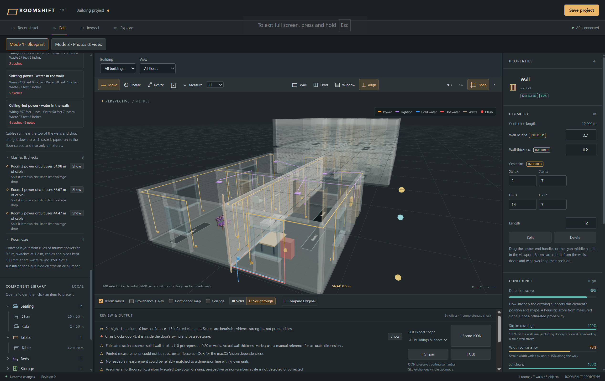
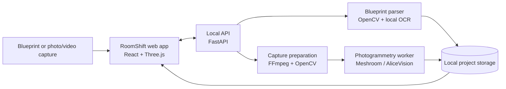

# RoomShift

RoomShift turns a floor plan, photo set, or short room walkthrough into an editable 3D space. Upload a blueprint to build a metric room layout, or capture a room from photos/video to create a mesh. Then inspect the result, edit walls and furniture, plan basic services, and export the scene.



## Architecture



The web app provides the editor, 3D viewport, project controls, and exports. The local API owns uploads, reconstruction jobs, validation, and project persistence. Blueprint reconstruction produces editable rooms, walls, doors, and windows; capture reconstruction produces a calibrated mesh that can be opened in the same editor.

## Features

- Upload PNG or JPEG blueprints and reconstruct editable metric rooms.
- Use printed dimensions, an estimated scale, or a manual reference measurement.
- Upload a 10–60 second walkthrough or 20–40 overlapping photos to reconstruct a colored room mesh.
- Calibrate mesh scale and floor alignment from picked points.
- Draw and edit walls, doors, and windows with snapping, undo/redo, and completeness checks.
- Add, transform, resize, and snap furniture; import local GLB, glTF, OBJ, PLY, or STL components.
- Review provenance and confidence, compare against the original, and lay out conceptual wiring and plumbing.
- Group floors and buildings, save projects locally, and export Scene JSON or GLB.

## Run locally

RoomShift requires Python 3.12+ and Node 22.12+. For automatic scale and room names install
[Tesseract OCR](https://tesseract-ocr.github.io/) with English data (macOS can use the built-in Vision
OCR instead); for video captures install FFmpeg.

```bash
# Debian/Ubuntu: sudo apt install tesseract-ocr ffmpeg   ·   Arch: sudo pacman -S tesseract tesseract-data-eng ffmpeg
# macOS: brew install tesseract ffmpeg                    ·   Windows: winget install UB-Mannheim.TesseractOCR Gyan.FFmpeg
```

Start the API in one terminal:

```bash
cd services/api
python -m venv .venv
.venv/bin/python -m pip install -r requirements.txt
.venv/bin/python -m uvicorn roomshift_api.main:app --host 127.0.0.1 --port 8000
```

Start the web app in a second terminal:

```bash
cd apps/web
npm ci
VITE_USE_MOCK_API=false VITE_API_BASE_URL=http://127.0.0.1:8000 npm run dev
```

Open <http://127.0.0.1:5173>.

<details>
<summary>Windows (PowerShell)</summary>

```powershell
cd services/api
python -m venv .venv
.venv\Scripts\python -m pip install -r requirements.txt
.venv\Scripts\python -m uvicorn roomshift_api.main:app --host 127.0.0.1 --port 8000
```

```powershell
cd apps/web
npm ci
$env:VITE_USE_MOCK_API = 'false'
$env:VITE_API_BASE_URL = 'http://127.0.0.1:8000'
npm run dev
```

</details>

For an offline blueprint demo without the API, use mock mode: `VITE_USE_MOCK_API=true npm run dev`.

Run the API as a single process (no `--workers` greater than 1): jobs and locks live in that process.
`--reload` is handy while developing the API, but it interrupts running reconstructions. The API is
local-only; see [its settings](services/api/README.md#run) to change ports, origins or limits.

Photo/video reconstruction also needs the local Meshroom worker. Follow [the reconstruction worker setup](services/reconstruction/README.md#meshroom-setup-default-engine). Project data is stored locally under `services/api/data/`.

## Verify

```bash
cd services/api
.venv/bin/python -m pytest -q
.venv/bin/ruff check .
```

```bash
cd apps/web
npm run typecheck && npm run lint && npm test && npm run build
npm run e2e                                    # Playwright (ROOMSHIFT_CHROMIUM=/path/to/chromium to reuse a system browser)
```

The worker's geometry tests run in its own environment: `services/reconstruction/.venv/bin/python -m pytest services/reconstruction/tests`.
GitHub Actions runs the API and web checks on every push and pull request.

See [the API guide](services/api/README.md), [the web-app guide](apps/web/README.md), and [the documentation index](docs/README.md) for more detail.
